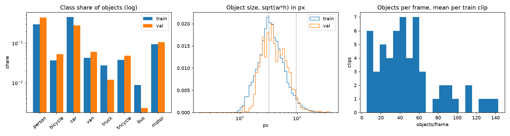
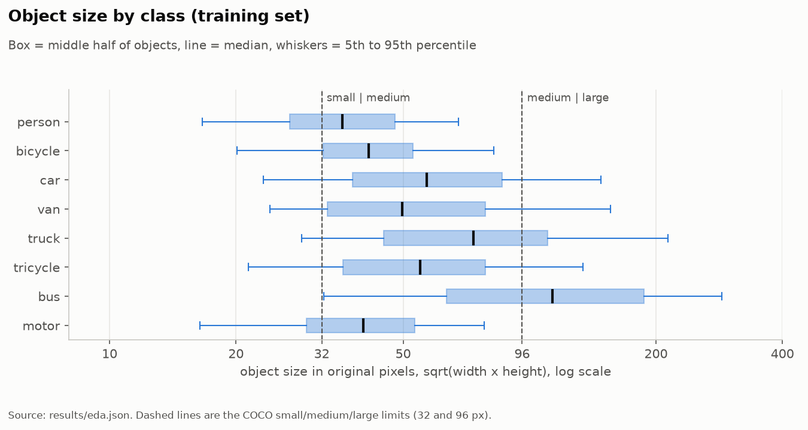
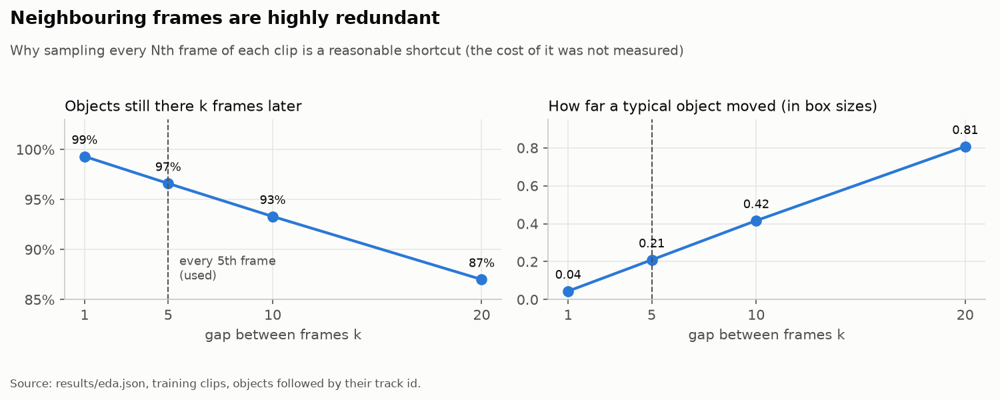
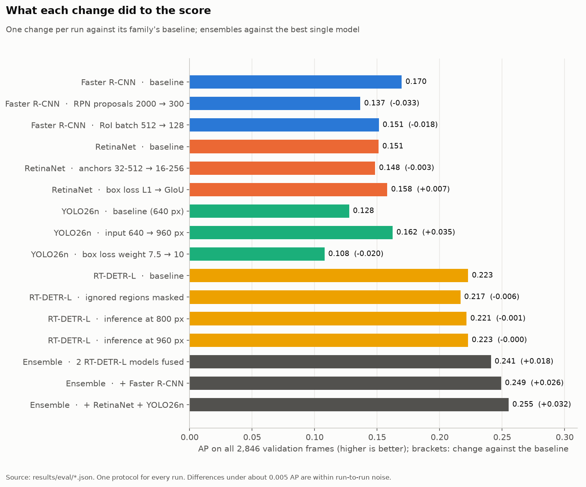
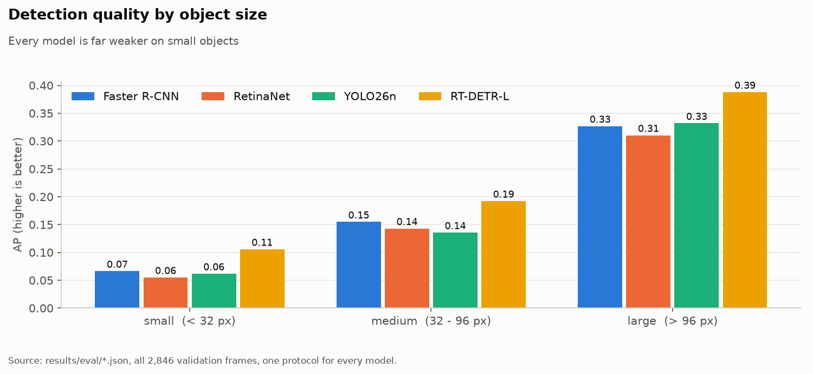
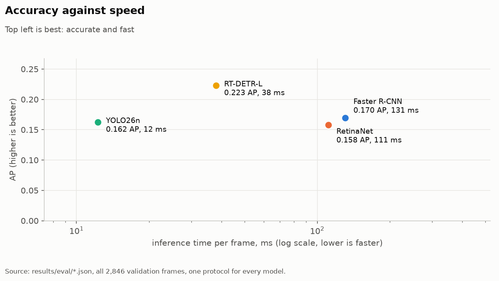
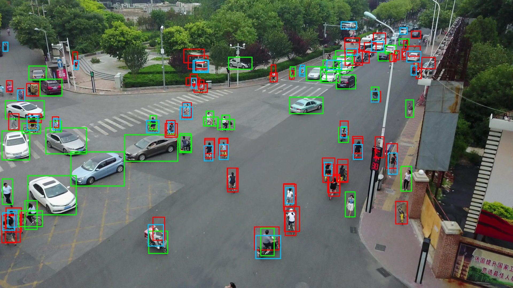
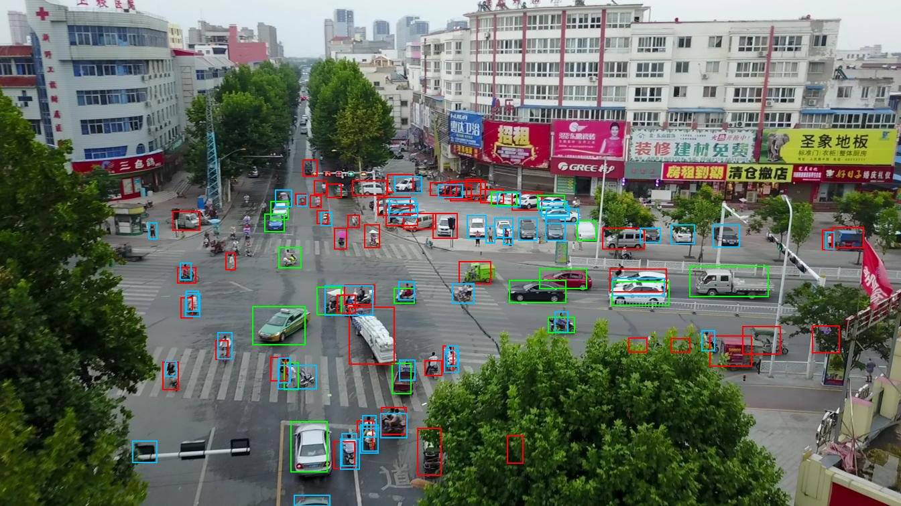
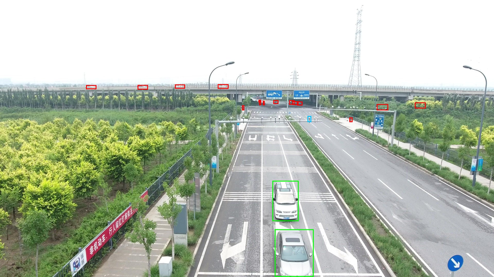
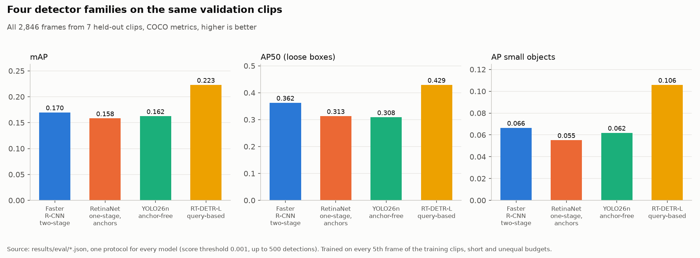

## 1. Task and summary

The task is to detect eight kinds of objects (person, bicycle, car, van, truck, tricycle, bus, motor) in frames of drone videos, scored by COCO-style mean average precision. I trained one detector from each of four families, tuned each one and combined their results. All code, logs and figures are in repository; every number below comes from reposiotry `results/` and `EXPERIMENTS.md`.

RT-DETR-L was the best individual model, with a validation AP of 0.223. Combining predictions from five models improved the validation AP to 0.255 and achieved 0.26656 on the public Kaggle leaderboard. Combining three models achieved 0.26288. These were my two final submissions. 

## 2. Data

The training split has 24,201 frames from 56 clips and 1.1 million labelled objects; validation has 2,846 frames from 7 clips and the test set 3,811 frames from 48 clips. Three properties shaped the work.

**Objects are small and crowded.** The median object is 46 px across (square root of box area), the 5th percentile is 20 px, and 25% of objects count as small (COCO: under 32 px). Cars and persons dominate (505k and 329k boxes); buses are rare (9.7k).

**A third of the labels are "ignore" regions.** 510,744 regions are marked as ignored (32% of the annotations in train). Detections inside them are not penalised, and the scorer respects this.

**Neighbouring frames are redundant.** 
Consecutive video frames are almost identical. After 5 frames, 96.6% of objects are still visible, and most have moved only about 20% of their size.
Therefore, I trained on every 5th frame (4,868 frames) to reduce training costs by roughly 5 times.
However, I didn't test training on all frames, so I can't confirm how much this affected accuracy.

Image resolutions also differ. Validation includes one 4K video with 978 frames (34% of validation), while test images are at most 1920 pixels wide. This difference may affect model performance, as explained in Section 6.

## 3. Methods

All models use COCO-pretrained weights and are fine-tuned on **4,868 training frames**. I evaluated them on **2,846 validation frames**, allowing up to 500 detections per frame.

I compared four detection architectures:

- **Faster R-CNN:** First finds possible objects, then identifies them and adjusts their boxes.
- **RetinaNet:** Uses predefined boxes (anchors) to detect objects in one step, focusing more on difficult examples.
- **YOLO26n:** Detects objects directly without predefined boxes.
- **RT-DETR-L:** Uses a transformer to detect objects and predict their boxes without needing duplicate removal.

**Model ensemble:** I combined predictions from different models using Weighted Box Fusion (WBF). When boxes of the same class overlap with IoU above 0.55, I merged them into one box, giving more weight to confident predictions.

All experiments use the same random seed (42) for reproducibility.

## 4. Experiments

Each family has a baseline and at least two tuned runs, changing one thing at a time.

| Family | Run | Change | AP | AP small |
|---|---|---|---:|---:|
| Faster R-CNN | baseline | defaults | **0.170** | 0.066 |
| | rpn300 | proposals kept 2000 → 300 | 0.137 | 0.061 |
| | roi128 | RoI samples per image 512 → 128 | 0.151 | 0.063 |
| RetinaNet | baseline | pretrained head layers kept | 0.151 | 0.047 |
| | anchors16 | anchor sizes 32–512 → 16–256 | 0.148 | 0.049 |
| | giou | box loss L1 → GIoU | **0.158** | 0.055 |
| YOLO26n | baseline | 640 px | 0.128 | 0.040 |
| | hires960 | input 960 px | **0.162** | 0.062 |
| | box10 | box-loss weight 7.5 → 10 | 0.108 | 0.038 |
| RT-DETR-L | baseline | default schedule with warm-up | **0.223** | 0.106 |
| | masked | ignored regions painted grey in training images | 0.217 | 0.098 |

**What helped.** 

1) YOLO: Increasing image resolution from 640 to 960 improved AP by 0.035, especially for small objects.
2) RetinaNet: Switching from L1 to GIoU loss improved AP by 0.007.
3) Ensemble: Combining models improved AP by 0.032 over the best individual model.

**What did not.** 

1) Faster R-CNN: Fewer proposed boxes and smaller RoI batches reduced accuracy, possibly because images contain many objects.
2) YOLO: Increasing the box loss weight reduced AP.
3) RetinaNet: Smaller anchors slightly improved object detection at IoU 0.5 but not overall AP.
4) RT-DETR: Masking ignored regions and increasing inference resolution did not improve overall AP.

**Speed.** YOLO26n takes 12 ms per frame, RT-DETR-L 38 ms, RetinaNet 111 ms and Faster R-CNN 131 ms. The five-model ensemble costs about 330 ms.

## 5. Failure analysis

I analyzed mistakes made by Faster R-CNN, using a confidence threshold of 0.3 and IoU of 0.5.

Main findings:
1) Object size: The model detects 67% of large objects, 52% of medium objects, and only 36% of small objects.
2) Object classes: It detects people and cars relatively well (61% recall), but struggles with bicycles (20%), buses (5%), and vans (3%).
3) Common mistakes: Vans are confused with cars, bicycles with motorcycles, and motorcycles with people.

**Case 1: riders and pedestrians (clip uav0000137_00458_v, frame 167; 64 missed, 33 false positives).** The model detects cars well but misses many cyclists and pedestrians. In this frame, it missed 64 objects and made 33 incorrect detections. One reason is that riders are labeled as two separate objects: a person and a bicycle. The model sometimes detects only one or predicts the wrong class.

**Case 2: dense, distant crossroads (uav0000182_00000_v, frame 226; 48 missed, 46 false positives).** The model misses small, distant vehicles and scooters.  A tree also blocks part of the view, making detection harder.

**Case 3: the 4K clip (uav0000268_05773_v).** The model detects only **12.5% of objects** in this 4K video, mainly missing small, distant vehicles. When the 4K images are resized, small objects become even harder to recognize. RT-DETR performs much better on large objects (**0.50 AP**) than on small ones (**0.006 AP**). The main problem is missed objects, not incorrect predictions.

## 6. Final results

| Submission | Members | Validation AP | Public LB |
|---|---|---:|---:|
| ens-5models | RT-DETR-L (new), RT-DETR-L (earlier run), Faster R-CNN, RetinaNet-GIoU, YOLO26n-960 | 0.255 | **0.26656** |
| ens-3models | the two RT-DETR-L models, Faster R-CNN | 0.249 | 0.26288 |

Combining models improved detection for every class:
- **Bus:** AP increased from 0.219 to 0.258.
- **Bicycle:** AP increased from 0.186 to 0.228.

This worked because different models make different mistakes.

My Kaggle scores were higher than validation scores. One possible reason is that validation contains a difficult 4K video, while test images have lower resolutions. However, this explanation hasn't been confirmed.

## 7. Limitations

Each experiment used one random seed and limited training, so small AP differences may not be reliable.

I did not test several possible improvements:
- **Temporal smoothing:** Using nearby video frames to improve predictions.
- **Test-time augmentation:** Testing different versions of the same image and combining predictions.
- **Tiling:** Splitting large images into smaller parts to detect tiny objects better.

Finally, ensemble improves accuracy but is too slow for real-time detection.

## References

- Zhu, P. et al. (2021). Detection and Tracking Meets Drones Challenge. *IEEE TPAMI*. (VisDrone dataset)
- Lin, T.-Y. et al. (2014). Microsoft COCO: Common Objects in Context. *ECCV*.
- Ren, S. et al. (2015). Faster R-CNN: Towards Real-Time Object Detection with Region Proposal Networks. *NeurIPS*.
- Lin, T.-Y. et al. (2017). Focal Loss for Dense Object Detection. *ICCV*.
- Redmon, J. et al. (2016). You Only Look Once: Unified, Real-Time Object Detection. *CVPR*. Models from Ultralytics (github.com/ultralytics/ultralytics).
- Zhao, Y. et al. (2024). DETRs Beat YOLOs on Real-time Object Detection. *CVPR*.
- Solovyev, R. et al. (2021). Weighted Boxes Fusion: Ensembling Boxes from Different Object Detection Models. *Image and Vision Computing*, 107.
- Rezatofighi, H. et al. (2019). Generalized Intersection over Union. *CVPR*.

*AI assistance: Claude (Anthropic) helped write the code; the experiments were run, and the choices were made, by the author.*